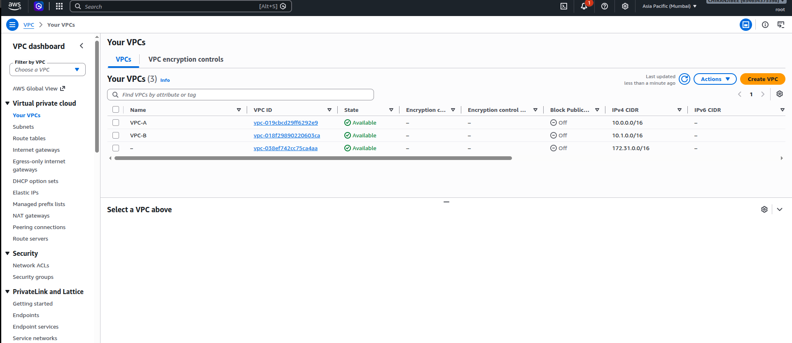
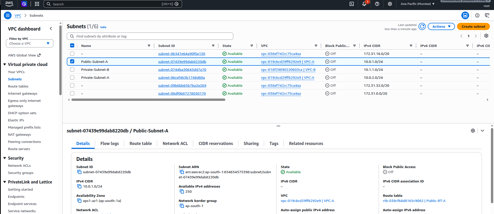
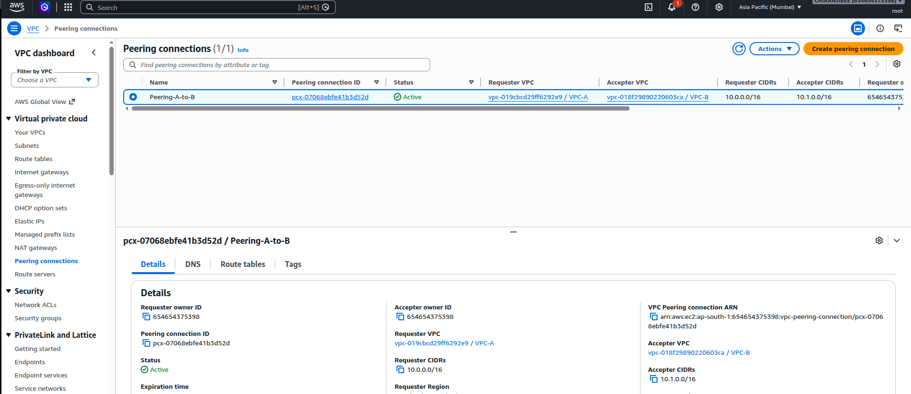
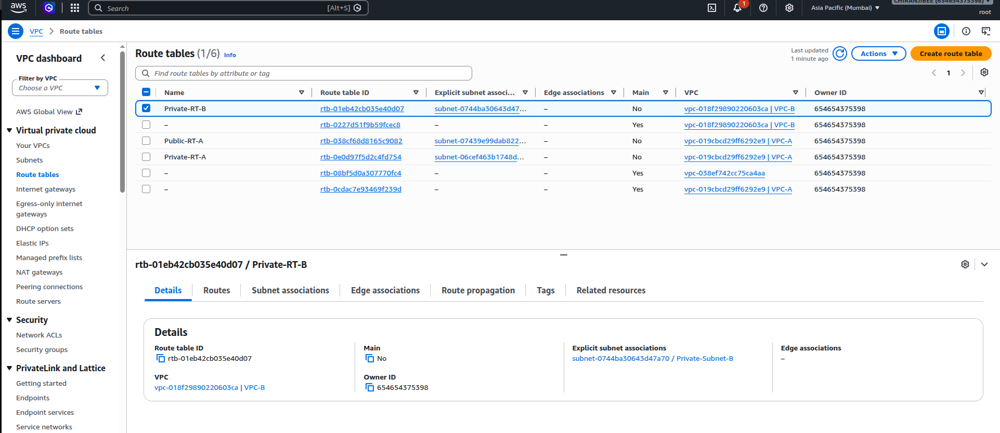
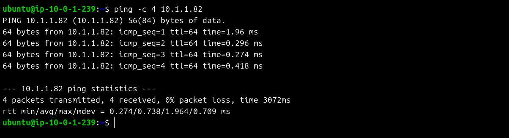

# 🌐 AWS VPC Peering: Private Cross-Network Connectivity

[](https://aws.amazon.com/)
[-FF9900)](https://aws.amazon.com/about-aws/global-infrastructure/regions_az/)
[](https://docs.aws.amazon.com/vpc/latest/peering/what-is-vpc-peering.html)
[-green)](https://en.wikibooks.org/wiki/OpenSSH/Cookbook/Proxies_and_Jump_Hosts)
[](./Subhransu_Sekhar_Lenka_EWB_VPC_Peering.pdf)

> **Student Project Workbook & Implementation Defense**  
> **Course:** AWS Certified Solutions Architect Associate / Cloud Networking Lab  
> **Author:** Subhransu Sekhar Lenka  
> **Evaluation Deliverable:** [Official Submission Report PDF (10 Pages)](./Subhransu_Sekhar_Lenka_EWB_VPC_Peering.pdf)  
> **Status:** Successfully Deployed, Tested, and Verified with 0% Packet Loss  

---

## 📖 Table of Contents
1. [Project Overview](#-project-overview)
2. [Explain Like a Student (The Diagram Breakdown)](#-explain-like-a-student-the-diagram-breakdown)
3. [Architecture & Network Diagram](#-architecture--network-diagram)
4. [Resource Inventory & Addressing Plan](#-resource-inventory--addressing-plan)
5. [Step-by-Step Implementation](#-step-by-step-implementation)
6. [Security Architecture & SSH ProxyJump](#-security-architecture--ssh-proxyjump)
7. [Visual Evidence & Test Results](#-visual-evidence--test-results)
8. [Controlled Failure & Resilience Testing](#-controlled-failure--resilience-testing)
9. [Student Viva & Interview Defense (FAQ)](#-student-viva--interview-defense-faq)
10. [Resource Cleanup](#-resource-cleanup)

---

## 🎯 Project Overview

In real-world cloud architectures, production databases, microservices, and internal backend workloads must **never** be exposed directly to the public internet. However, different departments, environments, or microservices often reside in separate Virtual Private Clouds (VPCs). 

This project establishes a high-performance, private, and encrypted communication link between two isolated VPCs using **AWS VPC Peering**.

### Key Objectives:
- **Zero Internet Exposure**: Connect two isolated private subnets across distinct VPCs (`VPC-A` and `VPC-B`) using only their private IPv4 addresses.
- **Controlled Administrative Ingress**: Deploy an SSH **Bastion Host** (Jump Box) in a public subnet to allow administrators secure access to private instances without exposing private workloads to the world.
- **Keyless Remote Management**: Use OpenSSH `ProxyJump` from a local machine so private keys (`.pem`) are never uploaded or stored on intermediary cloud servers.
- **Granular Security**: Implement least-privilege Security Groups with strict `/32` host whitelisting and bidirectional route table rules.

---

## 🎓 Explain Like a Student (The Diagram Breakdown)

If you're studying for your AWS Solutions Architect exam or trying to wrap your head around cloud networking, here is the simplest way to visualize this setup:

```
Imagine two separate, fenced-off company buildings: Building A (VPC-A) and Building B (VPC-B).

1. Building A has a front entrance facing the public street (the Internet Gateway).
2. Inside Building A's lobby sits a security receptionist (the Bastion Host).
3. In the back rooms of Building A and Building B are secure vaults (App-A and App-B).
   Neither vault has windows or doors facing the outside street.
4. How do the two vaults talk without walking out onto the public street?
   We dig a private underground tunnel directly between Building A and Building B:
   👉 That underground tunnel is AWS VPC Peering (pcx).
```

### Breaking Down Every Piece of the Diagram:

* **Why two VPCs?**
  * In enterprises, different teams or environments (e.g., Development vs. Production, or Shared Services vs. Application) live in separate VPCs for billing, security, and blast-radius isolation.
* **Why `10.0.0.0/16` and `10.1.0.0/16`?**
  * CIDR blocks **must never overlap**. If both VPCs used `10.0.0.0/16`, AWS wouldn't know which network a packet belongs to, and VPC peering would immediately fail.
* **Why is the Internet Gateway only on VPC-A?**
  * Only VPC-A needs to communicate with the outside internet to allow remote SSH management. VPC-B is completely private and has **no Internet Gateway**.
* **Why does creating a Peering Connection alone NOT work?**
  * This is the classic AWS gotcha: Creating and accepting a peering connection builds the physical tunnel, but the routers (route tables) don't know the tunnel exists until you explicitly tell them:
    * VPC-A's route table needs: *"If destination is 10.1.0.0/16, send it into the peering tunnel."*
    * VPC-B's route table needs: *"If destination is 10.0.0.0/16, send it back into the peering tunnel."*
    * **Networking is always a two-way street.** Without the return route, packets enter the tunnel but responses can never return!
* **Non-Transitive Routing (Crucial Rule):**
  * VPC Peering is strictly **non-transitive**. VPC-B cannot "piggyback" on VPC-A's Internet Gateway to browse the internet. Traffic cannot pass through a VPC to reach another destination.

---

## 🏛️ Architecture & Network Diagram

### Conceptual Flow


```
================================ AWS REGION: ap-south-1 (Mumbai) ================================

      [ Local Laptop (Admin) ]
                 │
                 │ SSH (Port 22) via Internet
                 ▼
      ┌──────────────────────┐
      │  Internet Gateway    │
      └──────────┬───────────┘
                 │
  ┌──────────────┴───────────────────────────────┐        ┌───────────────────────────────────────────────┐
  │  VPC-A (10.0.0.0/16)                         │        │  VPC-B (10.1.0.0/16)                          │
  │  VPC ID: vpc-019cbcd29ff6292e9               │        │  VPC ID: vpc-018f29890220603ca                │
  │                                              │        │  (No Internet Gateway attached)               │
  │  ┌────────────────────────────────────────┐  │        │  ┌────────────────────────────────────────┐  │
  │  │ Public Subnet (10.0.1.0/24)            │  │        │  │ Private Subnet (10.1.1.0/24)           │  │
  │  │ Subnet ID: subnet-07439e99dab8220db    │  │        │  │ Subnet ID: subnet-0744ba30643d47a70    │  │
  │  │                                        │  │        │  │                                        │  │
  │  │  [ EC2-Public-A / Bastion ]            │  │        │  │  [ EC2-Private-B ]                     │  │
  │  │  Private IP: 10.0.1.239                │  │        │  │  Private IP: 10.1.1.82                 │  │
  │  │  Public IP:  13.233.38.136             │  │        │  │  Public IP:  None (Isolated)           │  │
  │  │  Security Group: SG-Public-Bastion     │  │        │  │  Security Group: SG-Private-Test       │  │
  │  └────────────────────────────────────────┘  │        │  └────────────────────────────────────────┘  │
  │                                              │        │                                               │
  │  ┌────────────────────────────────────────┐  │        │                                               │
  │  │ Private Subnet (10.0.2.0/24)           │  │        │                                               │
  │  │ Subnet ID: subnet-06cef463b1748d60a    │  │        │                                               │
  │  │ Route Table: Private-RT-A              │  │        │                                               │
  │  └────────────────────────────────────────┘  │        │                                               │
  └──────────────────────┬───────────────────────┘        └───────────────────────┬───────────────────────┘
                         │                                                        │
                         └─────────────── [ VPC PEERING (pcx) ] ──────────────────┘
                                      ID: pcx-07068ebfe41b3d52d
                                   Traffic: 10.0.0.0/16 <==> 10.1.0.0/16
```

---

## 📋 Resource Inventory & Addressing Plan

All resources were provisioned and tested in **AWS Asia Pacific (Mumbai) `ap-south-1`**:

| Component | AWS Resource Name | Resource ID / CIDR | Associated IP / Subnet | Role & Description |
| :--- | :--- | :--- | :--- | :--- |
| **VPC A** | `VPC-A` | `vpc-019cbcd29ff6292e9` | `10.0.0.0/16` | Requester VPC with public ingress |
| **VPC B** | `VPC-B` | `vpc-018f29890220603ca` | `10.1.0.0/16` | Accepter VPC, fully isolated |
| **Public Subnet A** | `Public-Subnet-A` | `subnet-07439e99dab8220db` | `10.0.1.0/24` (AZ: `ap-south-1a`) | Hosts public Bastion host |
| **Private Subnet A**| `Private-Subnet-A` | `subnet-06cef463b1748d60a` | `10.0.2.0/24` (AZ: `ap-south-1a`) | Internal workload subnet in VPC-A |
| **Private Subnet B**| `Private-Subnet-B` | `subnet-0744ba30643d47a70` | `10.1.1.0/24` (AZ: `ap-south-1a`) | Internal workload subnet in VPC-B |
| **Internet Gateway**| `ewb-igw-a` | `igw-xxxx` | Attached to `VPC-A` | Gateway for administrative SSH traffic |
| **VPC Peering** | `Peering-A-to-B` | `pcx-07068ebfe41b3d52d` | Active (`VPC-A` ↔ `VPC-B`) | Private bi-directional peering link |
| **Route Table A** | `Public-RT-A` | `rtb-038cf68d8165c9082` | Associated to `Public-Subnet-A` | Routes `0.0.0.0/0` → IGW, `10.1.0.0/16` → `pcx` |
| **Route Table B** | `Private-RT-B` | `rtb-01eb42cb035e40d07` | Associated to `Private-Subnet-B`| Routes `10.0.0.0/16` → `pcx` |
| **EC2 Bastion** | `EC2-Public-A` | Instance in `Public-Subnet-A` | Private: `10.0.1.239` \| Public: `13.233.38.136` | Jump host for secure admin access |
| **EC2 Workload**| `EC2-Private-B` | Instance in `Private-Subnet-B`| Private: `10.1.1.82` \| Public: **None** | Completely isolated target workload |

---

## 🛠️ Step-by-Step Implementation

### Step 1: Create VPCs & Subnets
1. Provisioned **VPC-A** with IPv4 CIDR block `10.0.0.0/16`.
2. Provisioned **VPC-B** with non-overlapping IPv4 CIDR block `10.1.0.0/16`.
3. Created **Public-Subnet-A** (`10.0.1.0/24`) and enabled auto-assign public IPv4 for instance launches.
4. Created **Private-Subnet-B** (`10.1.1.0/24`) with auto-assign public IPv4 **disabled**.

### Step 2: Internet Gateway & Ingress Routing
1. Created an Internet Gateway and attached it to **VPC-A**.
2. Created route table **Public-RT-A**, associated it with **Public-Subnet-A**, and added default route:
   * **Destination**: `0.0.0.0/0` → **Target**: Internet Gateway (`igw-xxxx`).

### Step 3: Establish VPC Peering Connection
1. In the VPC Console, initiated a Peering Connection:
   * **Name**: `Peering-A-to-B`
   * **Requester**: `vpc-019cbcd29ff6292e9` (VPC-A)
   * **Accepter**: `vpc-018f29890220603ca` (VPC-B)
2. Under **Actions**, accepted the peering request.
3. Verified the status transitioned to **`Active`** (`pcx-07068ebfe41b3d52d`).

### Step 4: Configure Bidirectional Routing
VPC Peering does **not** inject routes automatically. Explicit routing rules were configured on both sides:

* **In Route Table `Public-RT-A` (VPC-A):**
  * `10.0.0.0/16` → `local` (Default VPC-A route)
  * `0.0.0.0/0` → `igw-xxxx` (Internet access for Bastion)
  * `10.1.0.0/16` → `pcx-07068ebfe41b3d52d` (Direct traffic for VPC-B into peering link)

* **In Route Table `Private-RT-B` (VPC-B):**
  * `10.1.0.0/16` → `local` (Default VPC-B route)
  * `10.0.0.0/16` → `pcx-07068ebfe41b3d52d` (Return traffic for VPC-A through peering link)

---

## 🔒 Security Architecture & SSH ProxyJump

### Security Group Inbound Rules

| Security Group | Attached Instance | Type / Protocol | Port Range | Source Whitelist | Purpose |
| :--- | :--- | :--- | :--- | :--- | :--- |
| `SG-Public-Bastion` | `EC2-Public-A` | SSH (TCP) | `22` | Admin Public IP `/32` | Allow admin SSH ingress |
| `SG-Private-Test` | `EC2-Private-B` | SSH (TCP) | `22` | `10.0.1.239/32` (Bastion IP) | Allow jump access from Bastion |
| `SG-Private-Test` | `EC2-Private-B` | Custom ICMP IPv4 | Echo Request (`8/0`) | `10.0.0.0/16` (VPC-A CIDR) | Allow ping testing across peering |

> **Stateful Security Groups Note:** AWS Security Groups are **stateful**. Return traffic is automatically permitted, meaning no explicit outbound rule changes were required for return packets.

### Client-Side SSH ProxyJump Configuration
To adhere to cloud security best practices, the EC2 private key (`.pem`) was **never uploaded or stored on any EC2 instance**. Instead, administrative connections to private instances are proxied directly from the local developer machine:

Add the following to `~/.ssh/config`:
```ssh
# Bastion Host (Public Ingress)
Host aws-bastion
    HostName 13.233.38.136
    User ubuntu
    IdentityFile ~/.ssh/ewb-lab.pem
    IdentitiesOnly yes

# Private Target Instance in VPC-B
Host aws-private-b
    HostName 10.1.1.82
    User ubuntu
    IdentityFile ~/.ssh/ewb-lab.pem
    IdentitiesOnly yes
    ProxyJump aws-bastion
```

Now, connecting to the completely isolated instance in VPC-B requires just one command:
```bash
ssh aws-private-b
```
The SSH client transparently tunnels through the bastion host over private IP space.

---

## 📸 Visual Evidence & Test Results

### 1. VPC Configuration Overview
Both `VPC-A` (`10.0.0.0/16`) and `VPC-B` (`10.1.0.0/16`) active in `ap-south-1`:


---

### 2. Subnet Associations & CIDRs
Public subnet (`10.0.1.0/24`) and private subnets (`10.0.2.0/24`, `10.1.1.0/24`) mapped to respective VPCs:


---

### 3. Active VPC Peering Connection (`pcx-07068ebfe41b3d52d`)
Peering connection established between Requester (`VPC-A`) and Accepter (`VPC-B`):


---

### 4. Route Table Association (`Private-RT-B`)
Explicit subnet association and route configuration directing reverse traffic through `pcx`:


---

### 5. Successful Private ICMP Connectivity Test
Connected via SSH to `EC2-Public-A` (`10.0.1.239`) and pinged `EC2-Private-B` (`10.1.1.82`) over the private peering connection:



```text
ubuntu@ip-10-0-1-239:~$ ping -c 4 10.1.1.82
PING 10.1.1.82 (10.1.1.82) 56(84) bytes of data.
64 bytes from 10.1.1.82: icmp_seq=1 ttl=64 time=1.96 ms
64 bytes from 10.1.1.82: icmp_seq=2 ttl=64 time=0.296 ms
64 bytes from 10.1.1.82: icmp_seq=3 ttl=64 time=0.274 ms
64 bytes from 10.1.1.82: icmp_seq=4 ttl=64 time=0.418 ms

--- 10.1.1.82 ping statistics ---
4 packets transmitted, 4 received, 0% packet loss, time 3072ms
rtt min/avg/max/mdev = 0.274/0.738/1.964/0.709 ms
```

* **Packets Transmitted:** 4
* **Packets Received:** 4
* **Packet Loss:** **0%**
* **Average RTT:** **0.738 ms** (sub-millisecond private AWS backbone latency!)

---

## 🧪 Controlled Failure & Resilience Testing

To validate that security rules actively govern traffic rather than relying on default behavior:

| Test Scenario | Action Taken | Expected Observation | Result |
| :--- | :--- | :--- | :--- |
| **1. Baseline (Pre-Peering)** | Ran `ping 10.1.1.82` prior to route entry | Packets dropped (100% loss) | ✅ Verified (Isolated) |
| **2. Post-Peering Active** | Added routes on both route tables | Immediate ICMP replies, ~0.7ms | ✅ 0% packet loss |
| **3. Controlled Failure** | Removed inbound ICMP Echo rule from `SG-Private-Test` | Pings immediately time out | ✅ Confirmed Security Group enforcement |
| **4. Fault Recovery** | Reinstated inbound ICMP Echo rule | Pings resume immediately without instance reboot | ✅ Confirmed stateful rule reload |

---

## 🎓 Student Viva & Interview Defense (FAQ)

Here are the key technical questions asked during architecture defenses and AWS networking interviews:

### Q1: Why did we need to update Route Tables on BOTH sides?
> **Answer:** Network routing is bidirectional. When `EC2-Public-A` pings `EC2-Private-B`, the request packet arrives via the route to `10.1.0.0/16`. However, `EC2-Private-B` must send an ICMP Echo Reply back to `10.0.1.239`. If VPC-B does not have a route entry directing `10.0.0.0/16` back to `pcx`, the instance cannot determine the egress interface and the reply is dropped.

### Q2: Why does an "Active" Peering status not guarantee that ping will work?
> **Answer:** An `Active` status only indicates that AWS has established the physical link abstraction between the two VPCs. Communication will still fail if:
> 1. Either route table lacks the destination CIDR entry targeting the peering ID.
> 2. Security Groups do not permit inbound ICMP (Protocol 1 / Port 8).
> 3. Network ACLs (NACLs) explicitly deny private traffic.

### Q3: Can VPC-B reach the Internet through VPC-A's Internet Gateway over the peering link?
> **Answer:** **No.** AWS VPC Peering is strictly **non-transitive**. A VPC cannot act as an intermediate transit router between another VPC and an Internet Gateway or Direct Connect connection. To achieve transitive routing across multiple VPCs and centralized egress, AWS Transit Gateway (TGW) must be used.

### Q4: Why use SSH ProxyJump instead of copying `.pem` keys to the Bastion?
> **Answer:** If an attacker compromises an internet-facing bastion host where private keys are stored on disk, they immediately gain root/admin access to every private server in the infrastructure. `ProxyJump` keeps the private key strictly in memory on your local machine and uses the bastion purely as a TCP proxy (OpenSSH `-W` tunnel), eliminating credential theft risk.

---

## 🧹 Resource Cleanup

To prevent unnecessary AWS charges after completing evaluation:
1. **EC2 Instances**: Terminated `EC2-Public-A` and `EC2-Private-B`. Ensured root EBS volumes deleted upon termination.
2. **Peering Connection**: Deleted `pcx-07068ebfe41b3d52d` (this automatically invalidates the peer routes).
3. **Route Tables & Subnets**: Removed custom route entries, disassociated subnets, and deleted custom subnets.
4. **Internet Gateway**: Detached `ewb-igw-a` from `VPC-A` and deleted it.
5. **VPCs**: Deleted `VPC-A` and `VPC-B`.
6. Verified through AWS Billing Console that 0 active elastic IPs, NAT gateways, or EBS volumes remained.

---

## 📚 References & Standards
* [AWS VPC Peering Documentation](https://docs.aws.amazon.com/vpc/latest/peering/what-is-vpc-peering.html)
* [AWS VPC Routing Concepts](https://docs.aws.amazon.com/vpc/latest/userguide/VPC_Route_Tables.html)
* [OpenSSH ProxyJump Reference](https://man.openbsd.org/ssh_config#ProxyJump)
* Project Lab: EWB Cloud Labs — Student Project Workbook (AWS Architect Associate)
