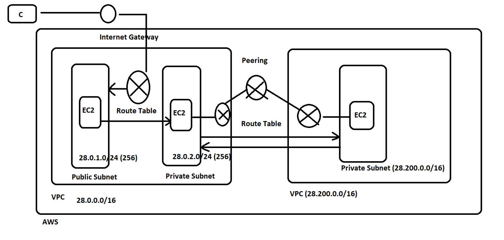

# AWS VPC Peering Project

## Project Overview

In this project, I implemented AWS VPC Peering to establish private communication between two separate Virtual Private Clouds (VPCs). The main objective was to understand how different VPCs can communicate securely using private IP addresses without sending traffic over the public internet.

I completed the project using the AWS Management Console in the Mumbai Region (`ap-south-1`).



## 1. Creating and Configuring VPCs

First, I created two VPCs: VPC-A and VPC-B. VPC-A uses the CIDR block `10.0.0.0/16`, while VPC-B uses `10.1.0.0/16`. These non-overlapping CIDR ranges allow the two networks to communicate through VPC Peering.

Inside VPC-A, I configured a public subnet with CIDR `10.0.1.0/24` and a private subnet. In VPC-B, I configured a private subnet with CIDR `10.1.1.0/24`. Subnets help divide a VPC into smaller networks for organizing and managing resources.

## 2. Configuring the Internet Gateway

I created and attached an Internet Gateway to VPC-A. This gateway allows resources in the public subnet to communicate with the internet when the appropriate route table entries, public IP addressing, and security rules are configured.

I configured the public subnet's route table to direct internet-bound traffic through the Internet Gateway. The private subnet was kept separate from direct public internet access.

## 3. Creating the VPC Peering Connection

Next, I created a VPC Peering connection between VPC-A and VPC-B. After establishing the connection, I verified that its status was Active.

VPC Peering acts as a private networking link between the two VPCs. It does not automatically configure routing, so I needed to update both VPC route tables to enable communication.

## 4. Configuring Route Tables

I added routes to direct traffic between the two VPCs through the peering connection.

In VPC-A, I configured the destination `10.1.0.0/16` with the VPC Peering connection as the target. In VPC-B, I configured the destination `10.0.0.0/16` using the same peering connection.

These routes allow traffic destined for the other VPC to follow the correct network path. Both directions must be configured for successful communication.

## 5. Launching EC2 Instances

I launched two EC2 instances to test the network configuration.

The first instance, EC2-Public-A, was placed in VPC-A's public subnet. It has the private IP address `10.0.1.239` and a public IP address for remote access.

The second instance, EC2-Private-B, was placed in VPC-B's private subnet. It has the private IP address `10.1.1.82` and no public IPv4 address. This setup demonstrates how a private instance can communicate with resources in another VPC without being directly accessible from the internet.

## 6. Configuring Security Groups

I configured security groups to control network traffic. The public instance uses `SG-Public-Bastion`, while the private instance uses `SG-Private-Test`.

The public instance's security group allows SSH access according to its inbound rules. The private instance's security group allows ICMP traffic from VPC-A's CIDR range, enabling ping-based connectivity testing.

## 7. Testing and Validation

Finally, I connected to EC2-Public-A through SSH and executed the following command:

```bash
ping -c 4 10.1.1.82
```

The test returned four successful replies, with four packets transmitted, four received, and zero packet loss. The average round-trip time was approximately `0.738 ms`.

This successful test confirmed that private ICMP communication between the two VPCs was working at the time of testing.

## Conclusion

Through this project, I gained practical experience with AWS VPCs, subnets, Internet Gateways, VPC Peering, route tables, security groups, and EC2 instances. I learned that creating a peering connection alone is not sufficient; correct routing and security configurations are also necessary.

This hands-on project helped me understand how AWS networking components work together to enable private communication between separate cloud networks.
